My solutions for some nice challenges so far.

**Hey friends!**

**I had so much fun in CATF finals and it was a really nice experience (I was laughing for 8 hours straight XD), huge thanks to all authors and organizers for this amazing event.**

**In this write-up, I’ll be sharing my solutions for [ELJoOker](https://www.eljooker.tech)’s two reverse engineering challenges.**

---

## 67 iq (first blood btw)

We got Linux file here, in DIE:

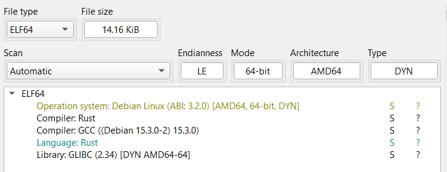

*64-bit ELF file, written in Rust, nice*

Running our game:

*It’s waiting for us to enter a 81-digit input (9\*9), left to right .. etc*

Of course we’re not gonna solve it the normal way (it will not be solved btw, it’s not even a real sudoku :D) so let’s open it in IDA and see what is it:

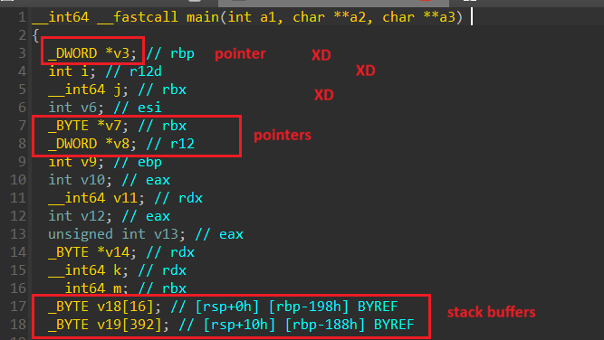

*i’m just pointing on these cause i think they’re important to remember*

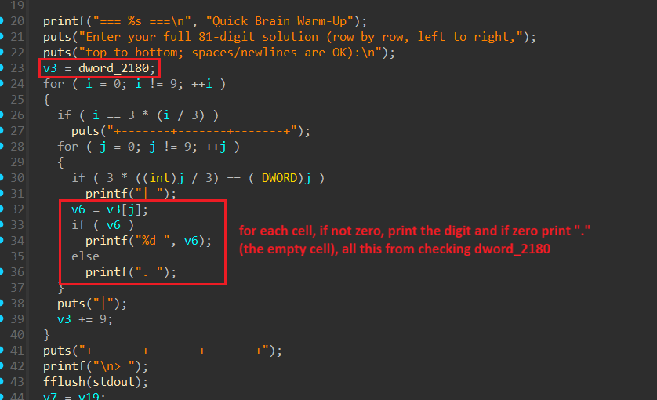

*this part prints the game starting lines and the sudoku grid, also it tells us that the random numbers (clues) and the empty cells all depend on the array `dword_2180`, pointed to by `v3`*

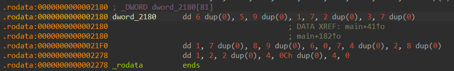

*this is an array of 81 (int)s (one int per sudoku cell), holds the puzzle’s given numbers that we saw, and we see that most of them are zeros (for ex: `dd 6 dup(0)` = repeat (0) 6 times, and we see the first 6 cells are empty in the game, then there is a 5, then 9 empty cells and so on)*

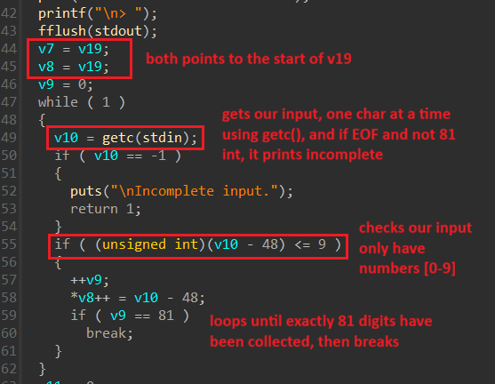

Note: I will not be going deep in the code cause I will not solve the challenge by reversing the code, we will use a faster way.

*this is a loop for hashing the stuff in `dword_2180` using some seed (v12), and counter (v11), it stops when exactly 81 are done*

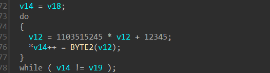

*this generates some keystream and stores it in v18*

Please note that **v18 only depends on v12** that is computed above from **fixed** stuff, so it is the same 16-byte keystream no matter what.

*this loop computes something using some array `byte_2120` and then compares it digit by digit to our input (remember that v7 is pointing to our input (v19)), if any cell mismatched, “Incorrect.” will pop up and the program will stops.. if clean, we will move to the next code.*

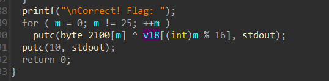

*this nice yummy loop constructs the flag using `byte_2100` stored in the binary and v18, then writes every char of it using putc() function.*

I don’t see our input here, do you?

I solved the challenge using a debugger, by setting a break point before the checking loop, entering a dummy 81-digit input, and redirecting the instruction pointer (RIP) to the flag construction loop.

Let’s see in action (I used IDA’s remote Linux debugger for this):

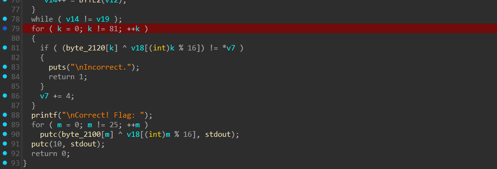

*first a break point here*

Running the program and entering dummy input:

*it runs and hits the break point*

*redirecting the RIP*

Then continue running, when returning to the terminal we see the flag.

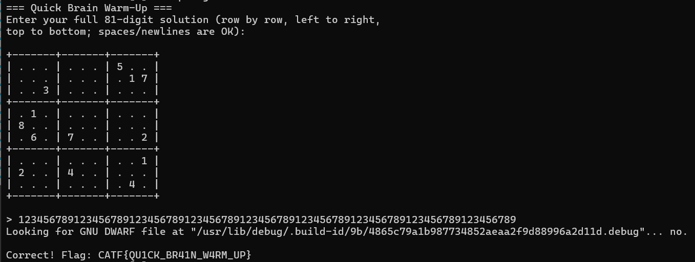

And here we go!
**Flag:** `CATF{QU1CK_BR41N_W4RM_UP}`

Btw we can solve it by patching and also by actually reversing the code and getting the right input, all great and all fun.

---

## /dev/null

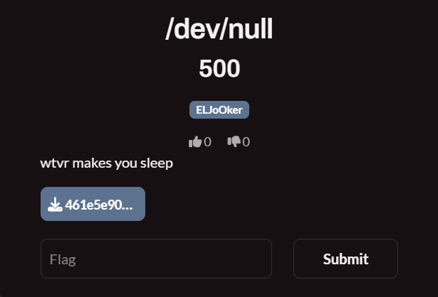

I didn't solve this challenge during the CTF (sadly😔), but now after I did, it's worth talking about, also I literally slept while solving it so it's doing its job.

Another Linux file here too..

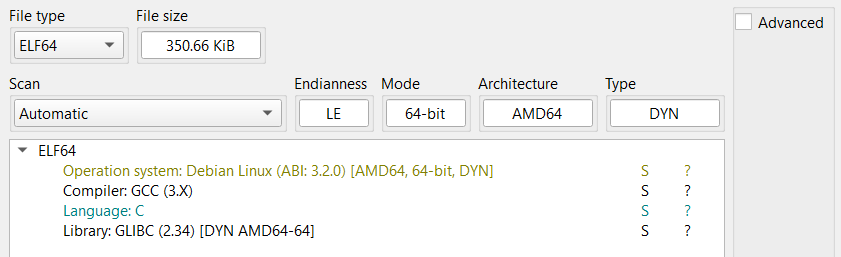

*hmmm*

Checking the strings ..

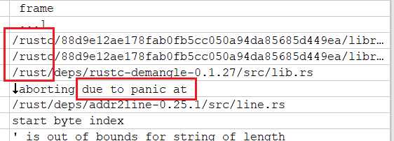

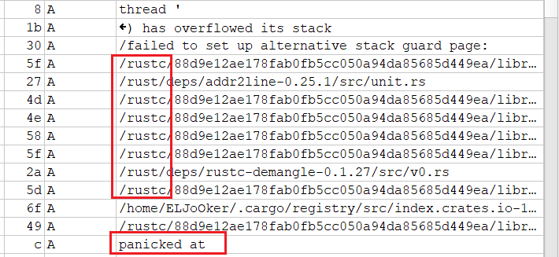

These (and a lot more) tell us that this program is written in **Rust**.

Running the binary:

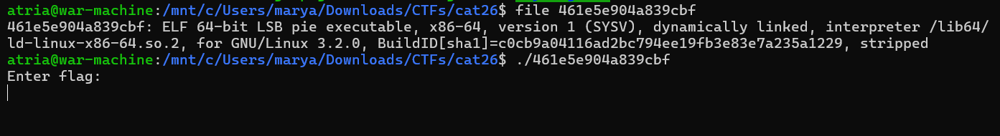

*wants the flag*

Opening with IDA, if we go to the `main` function, we will not see any program logic, but it is just **Rust's runtime bootstrap**, it sets things up then calls the real `main` or the actual program logic.

So I went to the strings and found interesting things.

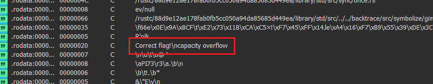

Finding where this string is being used, it's at the end of a huge function.

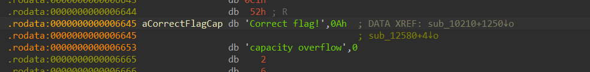

*XD*

Before going into the code, let me tell you about Rust's strings.

In C, a string is a pointer to the first character, and you find the end by walking forward until you hit a 0 byte (the NUL terminator), something like this:

`ptr ==> ['c' | 'o' | 'o' | 'k' | 'i' | 'e' | 0 ]  <-- wakes untill the 0`

Rust doesn't do that. It stores the length right next to the pointer, somthing like this:

`(ptr, len) = (0x9000, 6)`

`0x9000 ==> ['c' | 'o' | 'o' | 'k' | 'i' | 'e']   <-- no 0 at the end, len says "6"`

So a (&str) is this two values travelling together in two registers **(rdi, rsi)**, if you see a pointer followed by a number that looks like a length, think about it being a (&str).

Returning to our function, first thing we see is this:

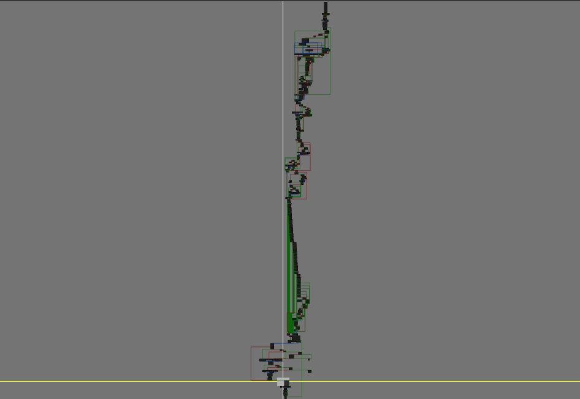

*the other stuff here are some checks on `stdout`, actually we may talk about it later*

Then I started scrolling hopping to find something interesting, till I found this block:

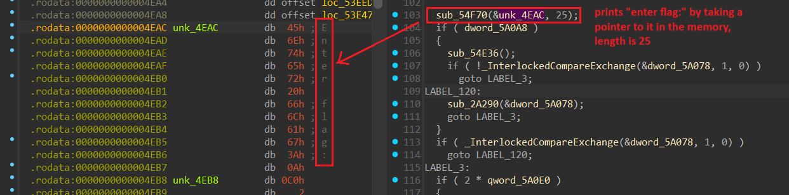

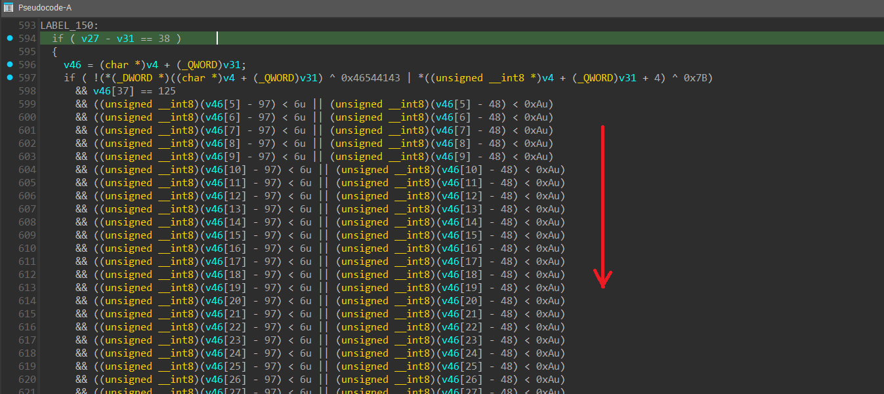

*after checking what we assumed is the length, (v46) will be the pointer to every byte of this "thing", then the if condition next is checking if the first 4 bytes are `0x46544143` by XORing them and if so, that should be zero, then checking if the next byte after them `(_QWORD)v31 + 4` is `0x7B`, and the last byte should == `125` (0x7D).. both 2 XORs should result in 0, and every line starts with `&&` must be true so the condition be true.*

`0x43` `0x41` `0x54` `0x46` is just **'C' 'A' 'T' 'F'**, `0x7B` is the **'{'** and `0x7D` is **'}'**

So now we know that this is checking on our flag.

The next (&&)s are checking on the stuff between the "{}" (chars from index [5] to [36] in the flag) :

*So the char must be 0–9 or a-f, which is a hex digit.*

Now we can say that the flag is **CATF{some 32 hex characters}**.

---

**To be continued soon XD**
